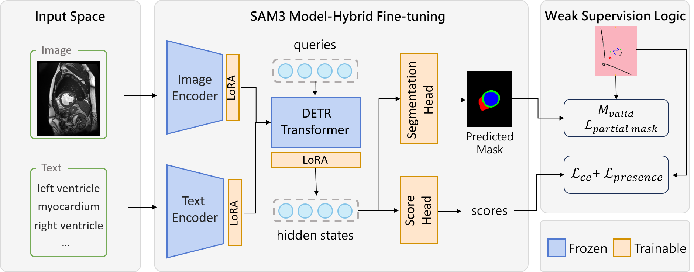

<div align="center">

# SAM3-Scribble

### 🧬 Adapting SAM3 to medical imaging with sparse scribble supervision

[](#installation)
[](#installation)
[](https://github.com/facebookresearch/sam3)
[](LICENSE)
[](#paper)

**[📄 Paper](#paper) · [🔬 Method](#overview) · [📦 Weights](checkpoints/README.md) · [🚀 Quickstart](#installation) · [📊 Results](#results)**

</div>

<a name="paper"></a>
## 📄 Paper

This repository provides the implementation accompanying:

> **Bridging weak supervision and promptable segmentation: Adapting SAM3 for medical imaging with sparse scribbles**  
> Qi Gao · Huihui Fang · Yanwu Xu  
> South China University of Technology · Pazhou Lab  
> *Manuscript under review at Computer Methods and Programs in Biomedicine (CMPB).*

<a name="overview"></a>
## 🔬 Method at a glance

SAM3-Scribble adapts the **text-prompted SAM3 image model** using sparse scribbles. At inference, an image and an anatomical class name specify the segmentation target.

<p align="center">
  
  <br />
  <sub>Paper framework. Blue denotes frozen base weights; orange denotes LoRA adapters or directly trained heads.</sub>
</p>

| 🖊️ Sparse supervision | 🧩 Matching and losses | ⚡ Hybrid adaptation |
|:---|:---|:---|
| Partial focal and Dice losses supervise annotated pixels; unmarked pixels remain unknown. | Box/GIoU regression and geometric matching costs are removed to avoid relying on incomplete scribble extents. | LoRA adapts the image, text, geometry and DETR pathway, with directly fine-tuned segmentation and scoring heads. |

**11.13M trainable / 848.16M total parameters (1.31%)** · **3 datasets** · **8 anatomical targets** · **CT + MRI**

<a name="results"></a>
## 📊 Results snapshot

Original seed-123 SAM3-Scribble test results reported in the manuscript:

| Dataset | Modality | DSC ↑ |
|:---|:---:|---:|
| ACDC | MRI | **91.61%** |
| BTCV_cervix | CT | **76.84%** |
| PROMISE12 | MRI | **90.36%** |
| **Equal-weight dataset macro-average** | — | **86.27%** |

Detailed ablations, paired statistics and additional measurements are linked [below](#reproducibility). SAM3-Full is the dense-supervision reference with the same adaptation capacity.

<a name="weights"></a>
## 📦 Pretrained checkpoints

**[Download SAM3-Scribble and SAM3-Full → Quark Drive](https://pan.quark.cn/s/291caf207228)**

The shared folder has **no extraction code** and **no configured expiry**. Checkpoint filenames, sizes and SHA-256 checksums are documented in [`checkpoints/`](checkpoints/README.md). If Quark prompts for sign-in or its client, follow its download instructions. Large weights are hosted separately from Git.

<a name="installation"></a>
## 🚀 Installation

Use Linux, Python 3.12 and a CUDA-compatible GPU. The observed preparation environment is recorded in `environment-observed.json`; it is not presented as a historical training lockfile.

```bash
git clone https://github.com/qigao-scut/SAM3-Scribble.git
cd SAM3-Scribble
python -m venv .venv
source .venv/bin/activate
python -m pip install torch==2.9.1 torchvision==0.24.1 --index-url https://download.pytorch.org/whl/cu126
python -m pip install -r requirements-review.txt
python -m pip install -e '.[train]'
```

Preserve the upstream [SAM License](LICENSE) and attribution. Obtain the official SAM3 initialization (`facebook/sam3`, `sam3.pt`) and the datasets from their providers under the applicable access terms.

<a name="data"></a>
## 🗂️ Data preparation

[`reproducibility/DATA.md`](reproducibility/DATA.md) describes the source layout and preparation command. The nine fixed case lists are in [`reproducibility/splits/`](reproducibility/splits/README.md). No medical images or annotation arrays are distributed here. Unmarked scribble pixels remain unknown; weak supervision uses `PartialMasks`, not dense loss on sparse traces.

<a name="training"></a>
## 🛠️ Training

From this package's root, set paths to prepared datasets and the official initialization. Each prepared dataset root contains `train/`, `val/` and `test/`.

```bash
export CMPB_REPO_ROOT="$PWD"
export CMPB_ACDC_ROOT="/path/to/prepared/acdc"
export CMPB_BTCV_ROOT="/path/to/prepared/btcv"
export CMPB_PROMISE12_ROOT="/path/to/prepared/promise12"
export CMPB_SAM3_INIT="/path/to/checkpoints/sam3.pt"
export CMPB_OUTPUT_ROOT="$PWD/outputs"

CUDA_VISIBLE_DEVICES=0,1 python sam3/train/train.py \
  -c configs/final/weak_lora.yaml --use-cluster 0 --num-gpus 2
```

Use `full_lora.yaml` for dense supervision. The remaining YAML files provide the regression, matcher, rank and adaptation-scope ablations. These configurations retain the original training settings; only filesystem paths are parameterized. The shared `weak_lora`/O2 reference is one configuration. Use a new output root for independent runs. Historical reference results used configured seed 123 and two RTX 4090 GPUs; settings for new runs must be recorded separately.

<a name="evaluation"></a>
## 🩻 Volume inference and evaluation

After training, the Dice-selected checkpoint is located at `checkpoints/val_mean_segmentation_coco_eval_segm_Dice.pt` under that run's output directory. For distributed weights, use the filename and checksum in the checkpoint manifest.

```bash
python gq_scripts/evaluate/batch_inference.py \
  --test_dir "$CMPB_ACDC_ROOT/test" \
  --checkpoint_path /path/to/checkpoints/sam3_scribble_seed123.pt \
  --confidence_threshold 0.7 --resize_size 1008 \
  --output_dir outputs/inference_acdc

python gq_scripts/evaluate/batch_evaluate.py \
  --predictions_file outputs/inference_acdc/predictions.pkl \
  --test_dir "$CMPB_ACDC_ROOT/test" --dataset_name ACDC \
  --spacing_file "$CMPB_ACDC_ROOT/test/spacing_map.json" \
  --output_dir outputs/inference_acdc
```

For BTCV and PROMISE12, change the test directory, output directory and `--dataset_name` to `BTCV` or `Promise12`; use their corresponding spacing maps. The preparation pipeline may store these at `_nifti_splits/test/spacing_map.json`. Always use actual source-image spacing, ordered as documented in the spacing JSON; do not substitute unit spacing. Evaluation computes 3D Dice, IoU, HD95 in mm and NSD with a 2 mm tolerance. Each prompted class is evaluated independently, including target-absent slices. ACDC paired tests use 15 patient averages; descriptive tables use 30 time-frame volumes.

<a name="reproducibility"></a>
## ✅ Reproducibility and additional results

`reproducibility/ablation_per_dataset.csv` contains the existing per-dataset ablation and threshold results. `reproducibility/results/paired_statistics.csv` contains the four-metric paired tests and mean differences; Dice/IoU/NSD are stored on the 0–1 scale, HD95 in mm. Positive `mean_improvement` favors SAM3-Scribble, with the sign reversed for HD95. `p_holm_by_metric` corrects the 15 comparisons within each metric family. Case dispersion is distinct from training-run dispersion.

Additional measurements are provided with their definitions and denominators:

| Measurement | Data | Notes |
|---|---|---|
| Parameters, FLOPs and peak GPU memory | [complexity_comparison.csv](reproducibility/complexity_comparison.csv) | [Workloads and precision](reproducibility/complexity_measurement_notes.md) |
| Candidate filtering and empty outputs | [candidate_filtering.csv](reproducibility/candidate_filtering.csv) | [Counting rules](reproducibility/candidate_filtering_notes.md) |
| Isolated slice errors | [slice_continuity_summary.csv](reproducibility/results/slice_continuity_summary.csv) | [Definitions and limits](reproducibility/results/slice_continuity_notes.md) |

```bash
python reproducibility/check_package.py
```

The package checks verify file hashes, split memberships, portable configuration paths and annotation rules without training or GPU inference. Installation in a fresh environment and full training have not been rerun as part of packaging. Baseline protocol details are in [`reproducibility/baselines.md`](reproducibility/baselines.md).

<details>
<summary><b>📚 Citation information</b></summary>

The manuscript is under review. If citing this work before publication, use an unpublished-manuscript entry:

```bibtex
@unpublished{gao2026sam3scribble,
  title = {Bridging weak supervision and promptable segmentation: Adapting SAM3 for medical imaging with sparse scribbles},
  author = {Gao, Qi and Fang, Huihui and Xu, Yanwu},
  year = {2026},
  note = {Manuscript under review at Computer Methods and Programs in Biomedicine}
}
```

</details>

---

Built on [SAM3](https://github.com/facebookresearch/sam3). Please preserve the upstream [SAM License](LICENSE) and attribution.
